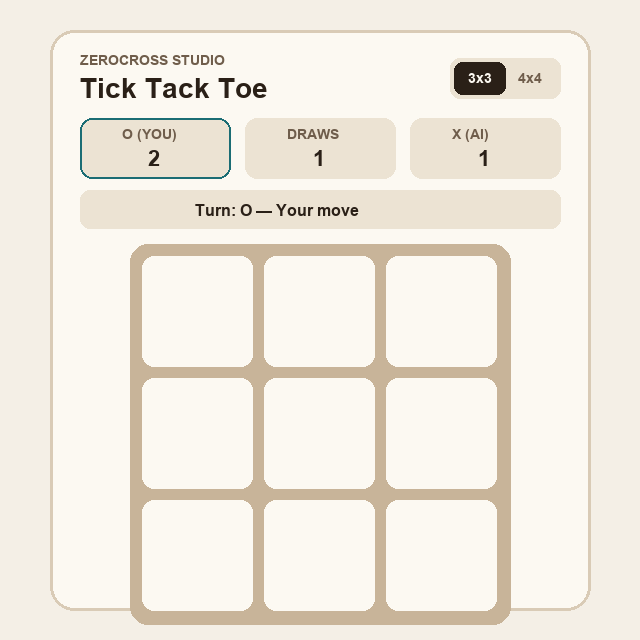

# Tick Tack Toe (ZeroCross)

Multi-framework implementation of **Tick Tack Toe (Zero Cross)** across **Python (Kivy)**, **Vanilla JavaScript**, **Vanilla TypeScript**, and **React + TypeScript**, live at [mk314k.github.io/ticktacktoe/](https://mk314k.github.io/ticktacktoe/).



## Implementations

1. **Python + Kivy (`Python_Kivy/`)**
   - `ZeroCross.py`: $N \times N$ board engine with representation invariant checks (`checkRep`), row/column/diagonal win line detection, draw detection, and alpha-beta pruned Minimax AI (`computeBestMove`).
   - `app.py` & `main.kv`: Desktop Kivy interface supporting both **vs Computer** and **2-Player Pass & Play** modes with live score tracking and winning-line highlights.

2. **Vanilla JavaScript (`Vanilla_JS/`)**
   - Zero-dependency ES6 module implementation (`zeroCross.js`, `app.js`, `index.html`, `style.css`) with move history undo, AI difficulty toggle (`Unbeatable` / `Casual`), and responsive CSS Grid layout.

3. **Vanilla TypeScript (`Vanilla_TS/`)**
   - Strictly typed `ZeroCrossEngine` (`src/zeroCross.ts`) and DOM controller (`src/app.ts`) supporting configurable $3 \times 3$ and $4 \times 4$ boards, depth-bounded alpha-beta search, and undo stack.

4. **React + TypeScript (`src/`, Hosted on GitHub Pages)**
   - Interactive React application built on top of the typed `ZeroCrossEngine` with:
     - **$3 \times 3$ & $4 \times 4$ Board Modes**
     - **vs Computer (`Unbeatable`, `Tactical`, `Casual`) & 2-Player Local Modes**
     - **Play as First (`O`) or Second (`X`)**
     - **Persistent Scoreboard (`localStorage`) & Full-Turn Undo**

## Running Locally

### Web App (React + TypeScript)
```bash
npm install
npm run dev
```

### Python Kivy App
```bash
cd Python_Kivy
python3 app.py
```

## License

Licensed under the [MIT License](LICENSE).
